# ClearCart

Describe what you need. Review a basket with an exact total. Approve a PayPal sandbox checkout yourself.

ClearCart is a focused PayPal AI hackathon project for shoppers who want to express several requirements and see the full cost before checkout. Its owned sample catalog keeps the demonstration small enough to inspect: the AI interprets preferences, while ordinary server code controls prices, materials, budget limits and payment truth.

[Watch the 95-second captioned demo on YouTube](https://www.youtube.com/watch?v=slJc7aeOWz8). Actual request and verification footage, screenshots and omitted login/idle intervals are labeled. The demo uses genuine Gemini and PayPal sandbox integrations with fictional products and funds.

## Run locally

Judges: start with [the complete judging guide](docs/judging.md). It includes a fresh-clone setup, expected shopping results, free real-provider setup and the distinction between sample checkout and a genuine sandbox capture.

Requires Node.js **24 or later** and npm. No paid hosting, model subscription or payment account is required to run sample mode.

```powershell
npm ci
if (-not (Test-Path .env.local)) { Copy-Item .env.example .env.local }
npm run dev
```

Open http://127.0.0.1:3000. Try **“A lightweight travel kit under $75, no leather.”** The complete demo basket should cost **$74**, including $5 shipping. Review it and explicitly approve sample checkout. The app must label the receipt as a sample order.

```powershell
npm test
npm run typecheck
npm run build
npm start
```

The SQLite ledger is created at `data/clearcart.sqlite` and ignored by Git. This version supports one local Node process; it is not configured for stateless/serverless hosting or production fulfillment.

## Connect free AI and real PayPal sandbox

Follow [provider setup](docs/provider-setup.md). Fill in `.env.local` locally and restart the server. Never commit or paste secrets into chat.

| Variable | Use |
|---|---|
| `APP_URL` | Set explicitly to the browser origin; `.env.example` uses `http://127.0.0.1:3000` for PayPal return navigation |
| `GEMINI_API_KEY` | Enables real intent interpretation; blank means labeled keyword sample mode |
| `GEMINI_MODEL` | Default `gemini-3.5-flash-lite`; verify account free quota in AI Studio |
| `PAYPAL_CLIENT_ID` | Sandbox app Client ID |
| `PAYPAL_CLIENT_SECRET` | Sandbox app Secret; both PayPal values enable real sandbox calls |

The PayPal endpoint is permanently fixed to sandbox. Create a sandbox merchant app and a separate Personal sandbox buyer. The buyer approves checkout on PayPal's sandbox page. No live payment or real fulfillment is supported. Gemini receives the sample catalog and shopping request, never payment credentials or receipt details. Free-tier availability and quota are account-specific; do not enable paid billing to bypass a limit.

## What is real and what is simulated

| Component | Behavior |
|---|---|
| Catalog, stock, shipping, tax | Fictional owned sample data: USD, flat $5 shipping, zero demo tax; not a merchant quote or international tax calculation |
| Basket validation | Real server computation from catalog prices and explicit/text constraints, using integer cents |
| AI with a configured key | Actual Gemini structured-output call, followed by independent validation |
| AI without a key | Explicit keyword interpreter for supported examples; no model call |
| Payment with both sandbox credentials | Actual PayPal Orders create/approve/capture/retrieve flow using fake sandbox funds |
| Payment without credentials | Explicit simulated approval and synthetic payment evidence; never a PayPal transaction |
| Quotes and receipts | Real local SQLite persistence and browser-session ownership |

Genuine Gemini interpretation and a buyer-approved $74.00 USD PayPal sandbox capture were verified on 3 November 2026. See [the integration evidence](docs/evidence.md). Automated tests use controlled network responses; they do not prove live account access. A sample-only recording does not satisfy the hackathon's meaningful AI/PayPal integration requirement.

## Architecture

```mermaid
flowchart LR
  Shopper[Shopper request and budget] --> Intent[Gemini or labeled sample interpreter]
  Intent --> Basket[Catalog matcher and budget checks]
  Basket --> Quote[Session-owned saved quote]
  Quote --> Review[Buyer reviews exact total]
  Review --> PayPal[PayPal sandbox approval]
  PayPal --> Capture[Capture and retrieve payment]
  Capture --> Verify[Check capture status, identity, amount and currency]
  Verify --> Receipt[One persisted receipt]
```



Next.js/React renders the accessible storefront and hosts server routes. TypeScript/Zod constrain inputs and model output. Node's built-in SQLite stores immutable quote/order snapshots. Direct HTTP adapters keep Gemini and PayPal dependencies small.

Only server-issued quote IDs can start checkout. Prices, payment status, return URLs and receipts are never accepted from browser input. Quotes expire after 15 minutes. HTTP-only random sessions bind checkout to the shopper. Stable, persisted PayPal request UUIDs and serialized local calls let repeated callbacks reuse the same receipt. A `COMPLETED` order alone is insufficient: the completed capture must match the saved identity, USD amount and currency.

## Verification and limitations

The test suite covers complete basket totals, constraint violations, malformed inputs, payment verification, session ownership and repeated callbacks. Types, production build and a real browser sample flow are separate checks. See [project state](docs/project-state.md) for the current verification record and external checks still outstanding.

Genuine Gemini interpretation and the buyer-approved sandbox receipt are verified. No measured usability benefit is claimed yet; a timed shopping task with several users is still outstanding. The longer roadmap is broader catalogs, merchant-configured shipping and currencies, accessibility user feedback and reliable deployed judging access.

## Hackathon delivery

The [official rules](https://paypalaihackathon.devpost.com/rules), rechecked on 3 November 2026, set the submission deadline at **12 November 2026, 21:00 CET**, with an internal target of **11 November**. Public hosting is optional: complete repository setup/run instructions or a hosted working demo satisfy the functional-access requirement. This repository supplies the local-build route, verified from a fresh public clone. The [public YouTube demo](https://www.youtube.com/watch?v=slJc7aeOWz8) is 95 seconds long. Keep free working access until **15 December 2026, 17:00 CET**. Final hackathon submission remains pending.

## Team and credits

Built by Moses Fawole with Codex assistance. Application code: MIT. Third-party packages retain their respective licenses. Product artwork uses Lucide category icons and CSS rather than downloaded product photos.

Sources: [Baymard checkout research](https://baymard.com/lists/cart-abandonment-rate), [PayPal sandbox](https://developer.paypal.com/tools/sandbox/), [PayPal idempotency](https://developer.paypal.com/api/rest/reference/idempotency/), [Gemini pricing](https://ai.google.dev/gemini-api/docs/pricing).
