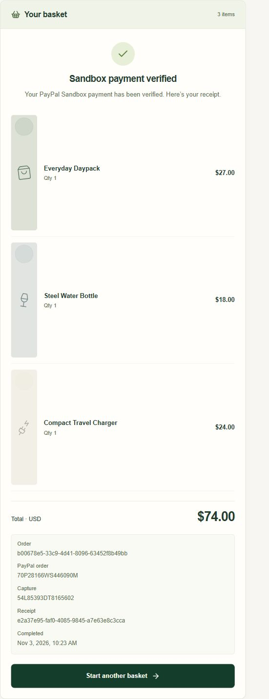

# Integration evidence — 3 November 2026

ClearCart completed a genuine Gemini shopping interpretation and a buyer-approved PayPal sandbox checkout. This was a local browser run using the entrant's free provider accounts, distinct from the controlled automated tests and the app's labeled sample mode.

| Check | Verified result |
|---|---|
| Request | Lightweight travel kit under $75, no leather |
| Products | Daypack $27, bottle $18, charger $24 |
| Complete total | $69 subtotal + $5 shipping + $0 demo tax = $74.00 USD |
| PayPal sandbox order | `70P28166WS446090M` |
| Completed capture | `54L85393DT8165602` |
| Saved receipt | `e2a37e95-faf0-4085-9845-a7e63e8c3cca` |
| Receipt timestamp | `2026-11-03T09:23:49.267Z` |
| Ledger assertions | Paid sandbox order; matching provider/order/receipt identities; 7400 cents USD; exactly one saved record for this capture |
| Real money moved | None |

The original merchant test failed with `PAYEE_ACCOUNT_LOCKED_OR_CLOSED` and stayed unpaid. A replacement Business sandbox merchant/app enabled the successful checkout. The Personal sandbox buyer explicitly approved the purchase. The initial return encountered a transient verification error; retrying the same order produced the verified receipt above.

The screenshot records the completed app state. A screenshot and controlled tests do not replace the hackathon's required demonstration video. A fresh run will generate different provider and receipt identifiers.

Show the verified sandbox receipt

